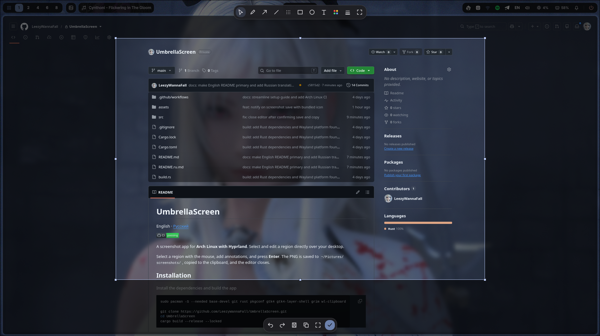

# UmbrellaScreen

[English](README.md) · Русский

[](https://github.com/LeezyWannaFall/UmbrellaScreen/actions/workflows/ci.yml)

Приложение для скриншотов на **Arch Linux с Hyprland**. Выделение области и редактирование работают поверх рабочего стола.

Выделите область мышью, добавьте пометки и нажмите **Enter**. PNG сохранится в `~/Pictures/screenshots/`, скопируется в буфер обмена, редактор закроется.



## Установка

Установите зависимости и клонируйте репозиторий

```sh
sudo pacman -S --needed base-devel git rust pkgconf gtk4 gtk4-layer-shell grim wl-clipboard

git clone https://github.com/LeezyWannaFall/UmbrellaScreen.git
cd UmbrellaScreen
```

Соберите и установите приложение одной командой

```sh
make install
```

Программа устанавливается в `~/.local/bin/umbrellascreen`. После обновления исходников повторите `make install`, чтобы установить новую версию.

## Запуск

Выполните в сессии Hyprland

```sh
~/.local/bin/umbrellascreen
```

Чтобы запускать приложение по **Print**, добавьте привязку в используемый конфиг Hyprland.

Для `hyprland.conf`

```ini
bind = , Print, exec, ~/.local/bin/umbrellascreen
```

Для `hyprland.lua`

```lua
hl.bind("Print", hl.dsp.exec_cmd("~/.local/bin/umbrellascreen"))
```

Примените изменения командой `hyprctl reload`.

## Редактор

- Перо, линия, стрелка, прямоугольник, эллипс и текст.
- Размытие исходного изображения внутри выделенного прямоугольника.
- Выбор цвета и толщины линий.
- Перемещение, масштабирование и вращение объектов.
- Отмена и повтор действий.

Наведите курсор на кнопку для подсказки. Для ввода текста выберите **T**, нажмите внутри снимка и подтвердите надпись клавишей **Enter**.

| Действие | Клавиша или жест |
| --- | --- |
| Сохранить, скопировать и закрыть | **Enter** |
| Сохранить PNG | **Ctrl+S** |
| Копировать PNG | **Ctrl+C** |
| Отменить / повторить | **Ctrl+Z** / **Ctrl+Shift+Z** |
| Удалить выбранный объект | **Delete** / **Backspace** |
| Закрыть | **Esc** |
| Переместить область снимка | Потянуть рамку |
| Переместить объект | Выбрать инструмент выбора и перетащить объект |
| Изменить размер объекта | Потянуть маркер на рамке |
| Повернуть объект | Потянуть маркер над рамкой |

Сочетания Ctrl работают независимо от раскладки. При вводе текста действуют обычные сочетания текстового поля. Кнопка с галочкой сохраняет и копирует снимок, затем закрывает редактор.

В режиме выбора используйте **Shift+клик** или **Ctrl+клик**, чтобы выделить несколько объектов. Их можно вместе перемещать, масштабировать, вращать и удалять.

## Сохранение

Каталог `~/Pictures/screenshots/` создаётся автоматически. Файлы получают уникальные имена и сохраняют разрешение выбранной области. После сохранения отправляется уведомление с миниатюрой и расположением файла. Для уведомлений нужен запущенный сервис уведомлений.

Содержимое экрана фиксируется при запуске. Область снимка ограничена одним монитором. При ошибке сохранения или копирования редактор показывает сообщение и остаётся открытым.

## Лицензия

[MIT](LICENSE)
